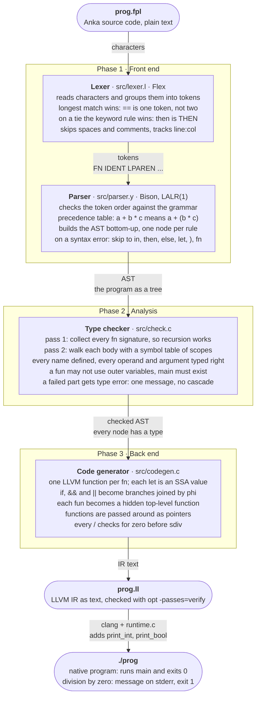

<div align="center">

# Anka

**A small functional language, compiled to LLVM IR**

[](https://github.com/merteldem1r/Compiler-Design-COME463/actions/workflows/ci.yml)


BIL/COME 463 Compiler Design · Fall 2026 · Prof. Ammar Daşkın

</div>

---

| | |
|---|---|
| **Author** | Mert Eldemir (student no. 25120205086), working alone |
| **Compiler** | `fplc`: source files `*.fpl` in, LLVM IR out |
| **Implementation** | Path A: C11 + Flex + Bison, IR emitted as text |
| **Specification** | [`docs/LANGUAGE.md`](docs/LANGUAGE.md) (Anka v1.0) |
| **Demo** | Tuesday 2026-12-15 |

This repository holds one compiler that grew over the semester. **Project 1** built a lexer. The **final project** turns it into `fplc`, a complete compiler for **Anka**, a small statically typed functional language. It is designed to be easy to read for both **humans and LLMs**, and part of the project measures how well an LLM can write it.

The name: the *Anka* is the phoenix of Turkish mythology. Its compiler rises from errors: it reports every error it can find in one run instead of stopping at the first.

## A taste of Anka

```rust
fn double(x: int) -> int = x * 2
fn apply(f: int -> int, x: int) -> int = f(x)        // functions are values

fn fact(n: int) -> int =
  if n <= 1 then 1 else n * fact(n - 1)              // `if` is an expression

fn main() -> int =                                   // the program runs main()
  let y = apply(double, 5) in                        // immutable local binding
  print_int(if y > fact(3) then y else fact(3))      // prints 10
```

| Feature | In Anka |
|---|---|
| Types | `int` (32-bit, wraps on overflow), `bool`, function types such as `int -> int` |
| Expressions only | `let … in`, `if … then … else`, anonymous functions `fun (x: int) -> x + 1` |
| Explicit signatures | every parameter and return type is written out; no type inference |
| Familiar calls | `f(a, b)`, as in C, Python or Rust; no partial application |
| Pure | no mutation, no loops (recursion instead), output only through `print_int` and `print_bool` |

## How the compiler works



| Stage | Source | Turns … into … | Look at it with |
|---|---|---|---|
| **Lexer** | `src/lexer.l` | text into tokens (`fn`, `x`, `->`, `42`, …), reporting bad characters with line and column | `--tokens` |
| **Parser** | `src/parser.y` | tokens into an **AST** (a tree of the program's structure). After a syntax error it skips to a safe token and continues, so one run reports several errors | `--emit-ast` |
| **Type checker** | `src/check.c` | AST into a checked AST: every name defined, every type correct, no anonymous function using outer variables | `--check` |
| **Code generator** | `src/codegen.c` | checked AST into **LLVM IR**, a readable assembly-like text that `clang` compiles together with a tiny C runtime | `--emit-ll` |

Every error has the same shape and goes to stderr. The exit status is `1` and nothing is generated:

```text
prog.fpl:3:14: error: condition of 'if': expected bool, found int
```

## Project status

| Part | Status |
|---|---|
| Project 1: lexer for Anka v0.2 (C-like) | Done, submitted and frozen in [`projects/project-1/`](projects/project-1/) |
| Language specification, Anka v1.0 | Done, reviewed 2026-11-27 |
| Phase 1: lexer update, parser, AST, `--emit-ast`, syntax error recovery | Next |
| Phase 2: type checker | Planned |
| Phase 3: LLVM code generation, runtime, full test suite | Planned |
| Report, LLM experiment, demo | Planned |

The schedule, the detailed checklist and the decisions log are in [`docs/PLAN.md`](docs/PLAN.md).

## Getting started

### Requirements

| Tool | Version used | Needed for |
|---|---|---|
| C compiler | Apple clang 21, gcc 15 (CI: Ubuntu gcc and clang) | building `fplc` (C11) |
| Flex | 2.6.4 | the lexer |
| GNU Bison | 3.8.2 (3.x required) | the parser; the Bison 2.3 that ships with macOS is too old |
| LLVM + clang | 23.1.6 (CI: 18.1.3) | `opt` to verify the IR, `clang` to build the program |
| make | any | building |
| Python 3 + tiktoken | optional | the BPE token-count comparison |

<details>
<summary><b>macOS (Homebrew)</b></summary>

```bash
brew install bison llvm
```

Both packages are *keg-only*: Homebrew doesn't put them on the PATH, because macOS already has its own `bison` and `clang`. You don't need to change the PATH; the Makefile finds them in `/opt/homebrew/opt/`.

</details>

<details>
<summary><b>Ubuntu / Debian</b></summary>

```bash
sudo apt-get install flex bison llvm clang make gcc
```

</details>

Check which tools the Makefile will use:

```bash
make tools
```

### Build and run

```bash
make                  # builds build/fplc
make clean            # deletes build/
```

> [!NOTE]
> **Right now** `fplc` is still the Project 1 token dumper: `./build/fplc --tokens prog.fpl` prints the token stream of a file. The commands below are the interface the finished compiler will have.

```bash
./build/fplc prog.fpl --emit-ast              # print the AST
./build/fplc prog.fpl --check                 # parse and type check only
./build/fplc prog.fpl --emit-ll -o prog.ll    # generate LLVM IR
clang prog.ll runtime.c -o prog && ./prog     # build and run the program
./run_tests.sh                                # build everything and run every test
```

## Tests

| Suite | Location | How to run | What it checks |
|---|---|---|---|
| Project 1 (frozen) | `projects/project-1/code/tests/` | `make -C projects/project-1/code test` | 8 files, 34 numbered lexer cases, each compared with a hand-checked expected output |
| Valid programs | `tests/valid/` *(coming)* | `./run_tests.sh` | the program's output |
| Error programs | `tests/errors/` *(coming)* | `./run_tests.sh` | the exact error messages |
| Recovery | `tests/recovery/` *(coming)* | `./run_tests.sh` | several errors reported in one run, with no cascades |

Expected outputs are worked out by hand, never copied from the compiler itself. `run_tests.sh` also checks every generated `.ll` file with `opt -passes=verify`.

## Repository layout

```text
.
├── README.md                 this file
├── Makefile                  make · make tools · make hooks · make clean
├── src/                      the compiler (lexer.l now; parser, type checker, code generator next)
├── tests/                    valid/ · errors/ · recovery/ (coming)
├── docs/
│   ├── LANGUAGE.md           Anka v1.0 specification, the source of truth
│   ├── PLAN.md               current plan, checklist, decisions, bugs found
│   ├── ROADMAP.md            semester overview
│   ├── SESSION_LOG.md        what was done in each work session
│   ├── AI_USAGE.md           how AI tools were used (required by the course)
│   └── lectures-notes/       course material from the instructor
├── projects/
│   ├── project-1/            submitted and frozen: assignment, report, lexer code + tests, study notes
│   └── final-project/        the final-project assignment text
├── .githooks/commit-msg      local commit-message check
├── .github/workflows/ci.yml  continuous integration on GitHub Actions
├── .claude/ · CLAUDE.md      rules and orientation for the AI coding assistant
```

Later phases add the deliverable files at the root: `SPEC.md` (a 2-page language summary), `runtime.c`, `run_tests.sh`, `examples/` (sample `.ll` output) and `REPORT.pdf`.

## Development workflow

- **Spec first.** `docs/LANGUAGE.md` changes before the code that implements it.
- **Commit messages** follow `type: summary` (`feat`, `fix`, `docs`, `test`, `refactor`, `chore`, `ci`), at most 72 characters, in imperative mood. Enable the local check once per clone with `make hooks`.
- **Continuous integration.** Every push and pull request runs on GitHub Actions (Ubuntu 24.04). It checks the new commit messages, builds `fplc` with gcc and clang with warnings treated as errors, and runs the tests.
- **AI use.** The course allows AI tools if their use is disclosed. This project uses Claude Code (Anthropic). Notable prompts and every mistake the AI made are logged in [`docs/AI_USAGE.md`](docs/AI_USAGE.md), and the author can explain every line.

## Credits

The lecture notes and assignment texts are by **Prof. Ammar Daşkın**, from the course repository [adaskin/compiler-course](https://github.com/adaskin/compiler-course/).

> [!IMPORTANT]
> This is coursework for a running course. Please don't copy or redistribute it as a solution.
